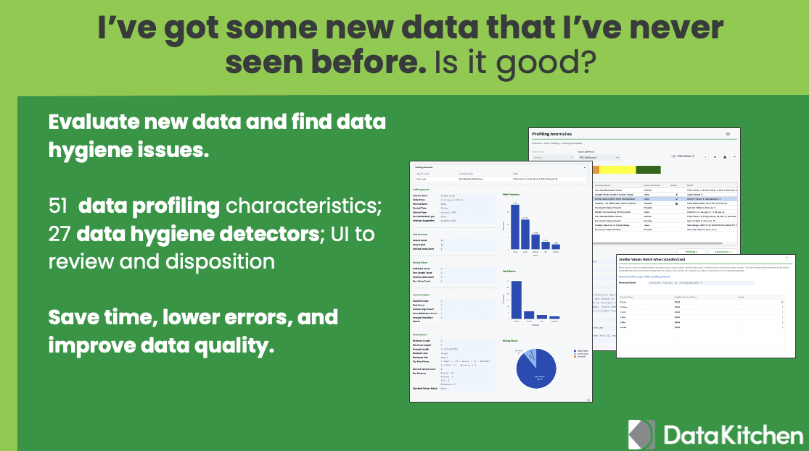
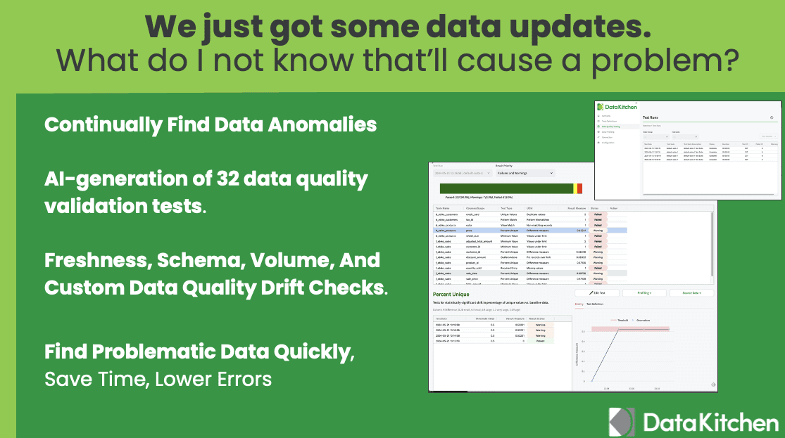
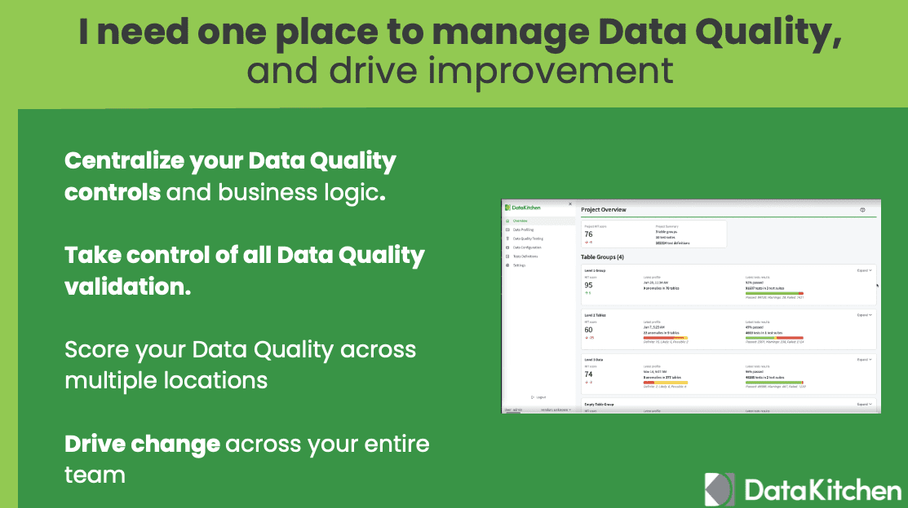

# DataOps TestGen

DataOps TestGen is an open-source data quality tool that profiles your tables, generates data quality tests and data contracts from the profile, and runs them on a schedule inside your database.

  [](https://hub.docker.com/r/datakitchen/dataops-testgen) [](https://hub.docker.com/r/datakitchen/dataops-testgen) [](https://docs.datakitchen.io/testgen/what-is-testgen/) [](https://data-observability-slack.datakitchen.io/join)

TestGen covers testing and monitoring in one tool: it watches freshness, volume, and schema between test runs. The open-source edition includes the full web UI, not just a library. You also get a REST API and an MCP server, so you can drive TestGen from your pipelines or an AI assistant. It is Apache 2.0 licensed and runs the same core engine and UI as TestGen Enterprise.

Install it with two commands (Python 3.9+, 8 GB memory; details in [Quick start](#quick-start)):

```shell
curl -o dk-installer.py 'https://raw.githubusercontent.com/DataKitchen/data-observability-installer/main/dk-installer.py'
python3 dk-installer.py tg install
```

[Interactive Product Tour](https://datakitchen.storylane.io/share/byag8vimd5tn) | [Product page](https://datakitchen.io/products/dataops-testgen/) | [Documentation](https://docs.datakitchen.io/testgen/what-is-testgen/)

## What it does

- Profiles every column in a table group and records type-specific statistics.
- Flags hygiene issues in new data, so you can review a dataset before it reaches production and send problems back to the supplier.
- Generates data quality validation tests from the profile. You can add your own SQL tests too.
- Writes a [data contract](https://docs.datakitchen.io/testgen/test-suites/contracts/) for each table: the schema plus a test behind every term, kept in numbered versions. Contracts import and export as [ODCS](https://github.com/bitol-io/open-data-contract-standard) (Open Data Contract Standard) YAML.
- Runs tests on a schedule, as SQL inside your database. Your data stays where it is.
- Watches each table between test runs with freshness, volume, and schema monitors.
- Gives you one place to manage data quality across datasets, locations, and teams.

<p align="center">

</p>
<p align="center">

</p>
<p align="center">

</p>

## How TestGen compares with Great Expectations and Soda

All three are open source and check data where it lives. The main difference is who writes the tests.

| | DataOps TestGen | Great Expectations (GX Core) | Soda Core |
|---|---|---|---|
| License | Apache 2.0 | Apache 2.0 | Elastic License 2.0 |
| Who writes the tests | TestGen generates them from a profile of every column; you can add your own SQL tests | You write each expectation in Python | You write each check in SodaCL (YAML) |
| Data profiling | Yes | Yes | Partial |
| Web UI in the open-source edition | Yes | No | No (the UI is Soda Cloud) |
| Freshness, volume, and schema monitoring | Yes | Partial | Partial |
| Data contracts | Generated from the profile; reads and writes ODCS | Partial | Yes, in SodaCL; no ODCS round trip |
| MCP server for AI assistants | Yes | No | No |

Great Expectations' commercial product, GX Cloud, shut down on June 1, 2026; GX Core continues under Fivetran stewardship. This comparison is DataKitchen's, last reviewed June 2026 (data contracts row November 2026). Full write-ups: [TestGen vs Great Expectations](https://datakitchen.io/comparisons/datakitchen-vs-great-expectations-gx-oss/) and [TestGen vs Soda Core](https://datakitchen.io/comparisons/datakitchen-vs-soda-oss/).

## Supported databases

As of TestGen 5.134.0, TestGen connects to 14 databases:

- Snowflake
- Databricks SQL
- DuckDB
- Azure Synapse Analytics
- Azure SQL Database
- Microsoft SQL Server
- Microsoft OneLake
- Google BigQuery
- Amazon Redshift
- Amazon Aurora PostgreSQL
- Oracle Database 12c and later
- SAP HANA
- PostgreSQL
- Salesforce Data 360

TestGen also reads CSV, Parquet, and JSON files on a local path, in Amazon S3, or in Azure Blob Storage, with no database in front. Every source works in both the open-source and Enterprise editions.

To set up a connection, see [Connect your data](https://docs.datakitchen.io/testgen/connect-your-data/).

## Quick start

The [dk-installer](https://github.com/DataKitchen/data-observability-installer/?tab=readme-ov-file#install-the-testgen-application) program installs TestGen in either Docker or pip mode.

You need 2 CPUs, 8 GB memory, 20 GB disk space. pip mode needs [Python](https://www.python.org/downloads/) 3.9+ to run the installer. Docker mode also needs [Docker](https://docs.docker.com/get-docker/) 27+ and [Docker Compose](https://docs.docker.com/compose/install/) 5.0+.

Download the installer into a new, empty directory:

```shell
curl -o dk-installer.py 'https://raw.githubusercontent.com/DataKitchen/data-observability-installer/main/dk-installer.py'
```

On Windows, you can instead download [`dk-installer.exe`](https://github.com/DataKitchen/data-observability-installer/releases/download/latest/dk-installer.exe) and double-click it.

Install TestGen:

```shell
python3 dk-installer.py tg install
```

The installer checks for Docker and asks you to pick Docker or pip. Pass `--docker` or `--pip` to skip the prompt. When it finishes, it writes credentials to `dk-tg-credentials.txt`, generates demo data, and opens the TestGen UI in your browser. Use `--no-demo` to skip the demo data.

Upgrade later with `python3 dk-installer.py tg upgrade`. Restart with `python3 dk-installer.py tg start`.

For complete instructions, see the documentation:

* [Install on Mac/Linux](https://docs.datakitchen.io/testgen/get-started/install-on-mac-linux/)
* [Install on Windows](https://docs.datakitchen.io/testgen/get-started/install-on-windows/)

Then walk through the [Data Observability Overview Demo](https://docs.datakitchen.io/tutorials/quickstart-demo/), and [connect your own database](https://docs.datakitchen.io/testgen/connect-your-data/).

## Use it from an AI assistant (MCP)

TestGen ships a Model Context Protocol (MCP) server in the open-source edition. Connect Claude, Claude Code, Cursor, GitHub Copilot, or any MCP client, and ask about your data in plain English. The assistant can profile tables, generate and run tests, and triage failures. Every tool runs under your own TestGen role, so the assistant can do only what you can do.

The installer serves the API and MCP server on port 8530 by default. Change it with `--api-port`.

Setup instructions: [docs.datakitchen.io/testgen/mcp](https://docs.datakitchen.io/testgen/mcp/)

## Open source vs Enterprise

The core profiling, testing, and monitoring engine is free and open source, with unlimited tables and unlimited data volume. Enterprise adds team access, security, Commercial Pharma tests, source-data controls for AI, and support.

| | Open source | Enterprise |
|---|---|---|
| License | Apache 2.0 | Commercial |
| Users | 1 | Unlimited, $100 per user per month |
| Database connections | 1 | Unlimited, $100 per connection per month |
| Projects | 1 | Unlimited |
| Enterprise security | | Included |
| Commercial Pharma test types (12) | | Included |
| Hide source data from AI clients (MCP) | | Included |
| Support | Community Slack | DataKitchen support |

See [datakitchen.io/pricing](https://datakitchen.io/pricing/) for current pricing.

## The 2026 landscape

How TestGen fits among the other tools, in DataKitchen's yearly landscape posts:

* [The 2026 Open-Source Data Quality and Data Observability Landscape](https://datakitchen.io/blog/the-2026-open-source-data-quality-and-data-observability-landscape/)
* [The 2026 Data Quality and Data Observability Commercial Software Landscape](https://datakitchen.io/blog/the-2026-data-quality-and-data-observability-commercial-software-landscape/)
* [The 2026 Open Source Data Profiling Software Landscape](https://datakitchen.io/blog/the-2026-open-source-data-profiling-software-landscape/)
* [The 2026 Data Contracts Software Landscape: Open Source and Commercial](https://datakitchen.io/blog/the-2026-data-contracts-software-landscape/)

## Documentation

* [DataOps TestGen documentation](https://docs.datakitchen.io/testgen/what-is-testgen/)
* [DataOps TestGen product page](https://datakitchen.io/products/dataops-testgen/)
* [Configuration (environment variables)](docs/configuration.md)
* [Local development](docs/local_development.md)

## Community

Talk with other data practitioners who build with DataKitchen. Share what you know, get help, and contribute.

* [Join us on Slack](https://data-observability-slack.datakitchen.io/join). This is also how you get support: post in the `#support` channel.
* [Star us on GitHub](https://github.com/DataKitchen/dataops-testgen)
* [Follow us on X](https://x.com/datakitchen_io)
* [Follow us on LinkedIn](https://www.linkedin.com/company/datakitchen)
* [Get free DataOps certification](https://datakitchen.io/certifications/)
* [Read our blog](https://datakitchen.io/blog/)
* [Sign The DataOps Manifesto](https://DataOpsManifesto.org)
* [Sign The Data Journey Manifesto](https://DataJourneyManifesto.org)

## Contributing

For details on contributing or running the project for development, see the [contributing guide](CONTRIBUTING.md).

## License

DataOps TestGen is Apache 2.0 licensed. See [LICENSE](LICENSE).
